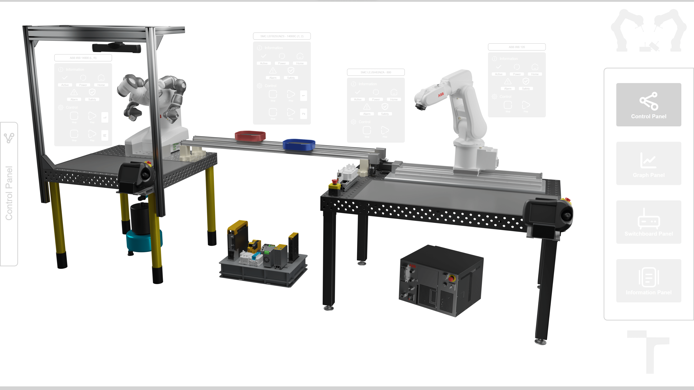
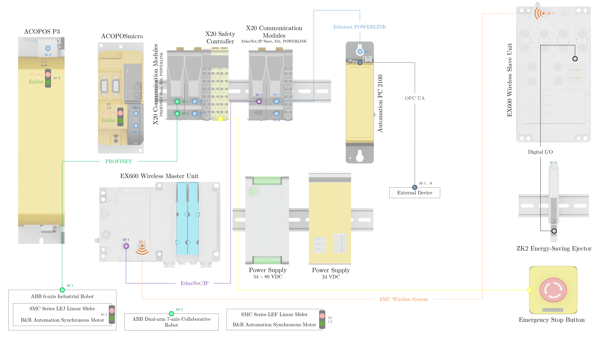
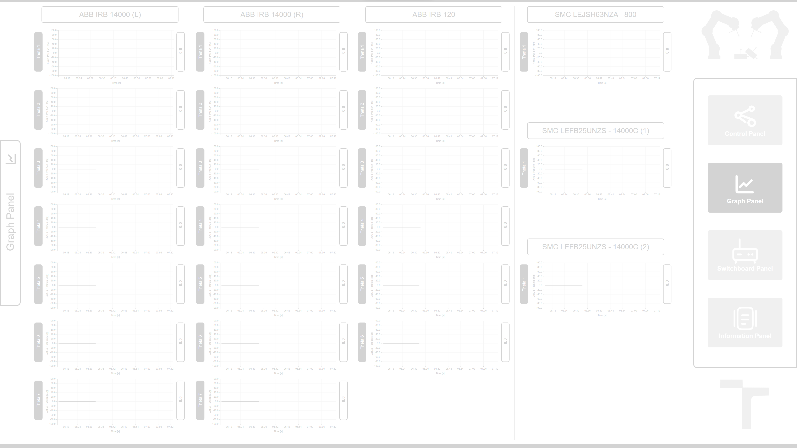
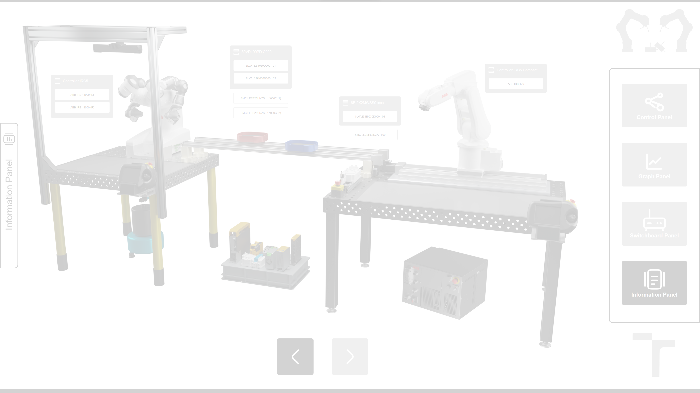
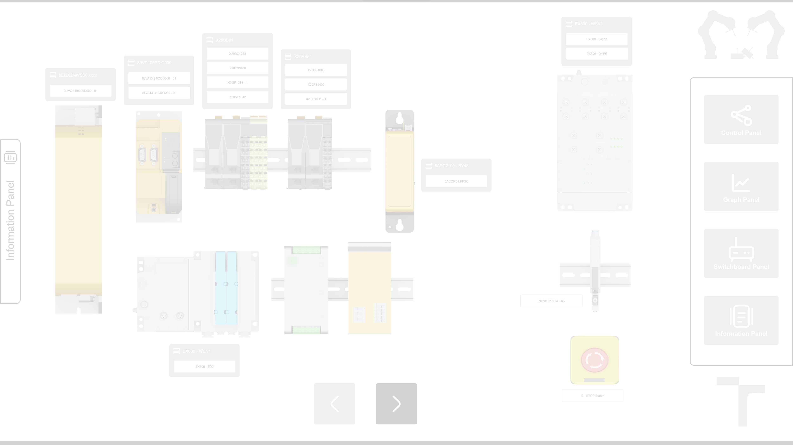
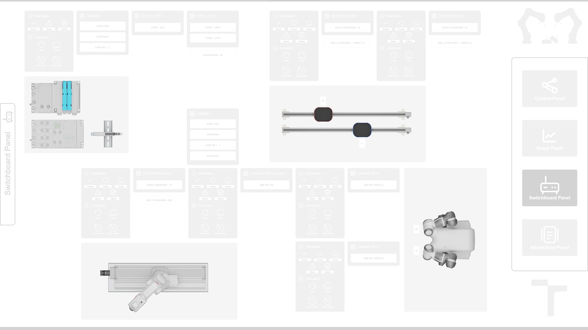

# VInRoS: B&R Automation Studio

<p align="center">
  <a href="LICENSE"></a>
  
  
  
  
  
  <a href="https://www.youtube.com/watch?v=7On3BkXgfiw"></a>
</p>

<p align="center">
  
</p>

This repository contains the **PLC, motion control, safety and HMI project** for the [Versatile Intelligent Robotic Workstation (VInRoS)](https://github.com/rparak/VInRoS_Overview). The project runs on a **B&R Automation PC 2100**, the central controller of the cell. It coordinates two ABB robots, three SMC linear axes and SMC wireless pneumatics, and serves a web-based **mappView** HMI and an **OPC UA** server for the [Unity3D digital twin](https://github.com/rparak/VInRoS_Unity3D_Simulation).

> Part of the VInRoS project. See **[VInRoS_Overview](https://github.com/rparak/VInRoS_Overview)** for the full system.

---

## Table of Contents

- [Features](#features)
- [Requirements](#requirements)
- [System Integration](#system-integration)
- [Project Structure](#project-structure)
- [Program Architecture](#program-architecture)
- [mappView HMI](#mappview-hmi)
- [Simulation Mode](#simulation-mode)
- [Getting Started](#getting-started)
- [Helpers](#helpers)
- [Related Repositories](#related-repositories)
- [Demo Video](#demo-video)
- [Citation](#citation)
- [License](#license)
- [Contact](#contact)

---

## Features

- **Multi-vendor orchestration.** One B&R controller drives ABB robots (PROFINET), SMC actuators on B&R drives (POWERLINK) and SMC wireless I/O (EtherNet/IP).
- **ABB robot control from the PLC.** A custom ANSI C library (`ABB_Library`) powers the robots on, uploads joint or TCP trajectories and starts or stops motion over PROFINET.
- **Axis control with mapp Axis.** The SMC linear axes are controlled through `MpAxisBasic` on ACOPOS P3 and ACOPOSmicro drives.
- **Unified data model.** All devices share one global structure (`Global_VInRoS_Str`) with consistent *Command / Info / Position* fields.
- **Integrated safety.** The X20 safety controller and emergency-stop circuit are handled with `AsSafety`.
- **Web HMI.** The mappView application has *Control*, *Graph*, *Switchboard* and *Information* pages.
- **OPC UA server.** It exposes the global data model to external clients such as the digital twin.
- **Simulation mode.** A single flag runs the whole cell against the digital twin instead of the real hardware.

## Requirements

**Software**

```text
B&R Automation Studio 4.12.5.95 SP
```

**Operating system**

```text
Windows
```

| Software / Package | Link |
| --- | --- |
| B&R Automation Studio | https://www.br-automation.com/en/downloads/#categories=Software-1344987434933 |

**Target hardware:** B&R Automation PC 2100 (`5APC2100.BY48-000`). For offline testing, use ARsim (Automation Runtime simulation).

## System Integration

<p align="center">
  
</p>

| Interface | Protocol | Devices |
| --- | --- | --- |
| X20 PROFINET slave modules | **PROFINET** | ABB IRB 120 (IRC5 Compact), ABB IRB 14000 (IRC5) |
| ACOPOS P3, ACOPOSmicro | **Ethernet POWERLINK** | B&R synchronous motors on the SMC LEJ and 2 × SMC LEF linear axes |
| X20 EtherNet/IP module | **EtherNet/IP** | SMC EX600 wireless master → EX600 slave → ZK2 vacuum ejector |
| X20 safety controller | Integrated safety | Emergency-stop circuit |
| Automation PC 2100 | **OPC UA** (port 4840) | Unity3D digital twin, external clients |

## Project Structure

```text
VInRoS_BaR_AS/
├── Helpers/
│   └── ping_ip.py                  # Scan the 192.168.0.x subnet for reachable devices
├── images/                         # README images
└── VInRoS_BaR_AS_Program/
    ├── VInRoS_BaR_AS_Program.apj   # Automation Studio project file
    ├── Logical/
    │   ├── Global.typ / Global.var # Global data model (Global_VInRoS_Str, SIMULATION_ENABLE)
    │   ├── T_ROB_1/                # ABB IRB 120
    │   ├── T_ROB_2_L/              # ABB IRB 14000, left arm
    │   ├── T_ROB_2_R/              # ABB IRB 14000, right arm
    │   ├── T_MECH_1/               # SMC LEFB25UNZS-14000C (1)
    │   ├── T_MECH_2/               # SMC LEFB25UNZS-14000C (2)
    │   ├── T_MECH_3/               # SMC LEJSH63NZA-800 (IRB 120 track)
    │   ├── T_EX600/                # SMC EX600 wireless I/O
    │   ├── mappView/               # HMI pages, layouts, widgets, resources
    │   └── Libraries/              # McAxis, MpAxis, AsSafety, FileIO, ...
    └── Physical/
        └── Config_5APC2100/        # Hardware configuration for the APC 2100
```

## Program Architecture

Each mechanism has its own cyclic ANSI C task, implemented as a **state machine**. The tasks talk to the rest of the system only through the global structure `Global_VInRoS_Str`:

```text
Global_VInRoS_Str
├── Rob_Id_1      (ABB IRB 120)          ┐
├── Rob_Id_2_L    (ABB IRB 14000 left)   ├─ Command | Info | Position.Q[0..6]
├── Rob_Id_2_R    (ABB IRB 14000 right)  ┘
├── Mech_Id_1..3  (SMC linear axes)      ── Command | Info | Parameters | Position
└── EX_600        (SMC wireless I/O)     ── Command | Info | Input[16] | Output[8]
```

| Field group | Contents |
| --- | --- |
| `Command` | `Power`, `Home`, `Start`, `Stop`, `Reset_Error`, `Reset_Safety` (axes also have `Update`, `Move`) |
| `Info` | `Active`, `Power`, `Home`, `Safety`, `Error`, `In_Position`, `Update_Done`, `Move_Active` |

**Robot tasks (`T_ROB_*`)** follow this sequence:

```text
ACTIVE → POWER → WAIT ─┬─ Start → UPDATE PARAMETERS → MOTION (loop over trajectory)
                       ├─ Home  → UPDATE HOME TARGET → HOME MOTION
                       └─ Stop / Safety / Error handling
```

Trajectories hold up to 100 joint targets (`Trajectory_Str.Targets.Joint[i].Q`), each with its own speed and zone. They are uploaded to the robot controller over PROFINET (`UPT_ID_TRAJECTORY_JOINT`) and executed as absolute joint moves (`MAIN_ID_JOINT_ABSOLUTE`). The library also supports linear TCP motion and tool-data updates.

**Mechanism tasks (`T_MECH_*`)** wrap `MpAxisBasic` with a similar sequence: power, home, parameter update (position, velocity, acceleration/deceleration), absolute move, stop, safety and error.

**`T_EX600`** maps the wireless I/O of the SMC EX600 slave unit (16 inputs and 8 outputs) to and from the global structure.

## mappView HMI

The HMI shows a 3D render of the cell, with a status panel for every robot and axis and four main pages:

| Page | Purpose |
| --- | --- |
| **Control** | Power, home, start, stop and reset for each mechanism, plus Active / Power / Home / Alarm / Safety indicators |
| **Graph** | Live trends of every joint (θ₁…θ₇ for each IRB 14000 arm, θ₁…θ₆ for the IRB 120, plus positions of the SMC axes) |
| **Switchboard** | Status of the electrical cabinet components (drives, X20 modules, power supplies, EX600, e-stop) |
| **Information** | Component and device information for the whole cell |

<p align="center">
  
</p>

<p align="center">
  
</p>

<p align="center">
  
</p>

<p align="center">
  
</p>

## Simulation Mode

The global constant `SIMULATION_ENABLE` (in `Global.var`) switches the cell between real hardware and the digital twin:

| `SIMULATION_ENABLE` | Behaviour |
| --- | --- |
| `FALSE` (default) | The tasks drive the real ABB robots, ACOPOS drives and EX600 I/O. |
| `TRUE` | Hardware calls are skipped. The PLC still runs the command logic, and the [Unity3D digital twin](https://github.com/rparak/VInRoS_Unity3D_Simulation) reads commands and trajectories over OPC UA, simulates the motion and reports `Move_Active` / `In_Position` back. |

This makes it possible to develop and test PLC logic and HMI screens (virtual commissioning) without access to the physical cell.

## Getting Started

1. Clone the repository:

   ```bash
   git clone https://github.com/rparak/VInRoS_BaR_AS.git
   ```

2. Open `VInRoS_BaR_AS_Program/VInRoS_BaR_AS_Program.apj` in **B&R Automation Studio 4.12**.
3. Check the hardware configuration (`Physical/Config_5APC2100`) and the IP addresses of the robots and EX600 so they match your network.
4. Choose the operating mode by setting `SIMULATION_ENABLE` in `Logical/Global.var`.
5. **Build** the configuration, then **transfer** it to the Automation PC (or start ARsim).
6. Open the mappView HMI in a web browser at `http://<PLC-IP>:81` (default mappView port).
7. *(Optional)* Connect the Unity3D digital twin to the PLC's OPC UA server at `opc.tcp://<PLC-IP>:4840`.

> The ABB controllers must run the matching RAPID programs from [VInRoS_ABB_RS](https://github.com/rparak/VInRoS_ABB_RS) for PROFINET robot control to work.

## Helpers

| Script | Description |
| --- | --- |
| `Helpers/ping_ip.py` | Pings `192.168.0.1`–`192.168.0.99` and reports which devices respond. Useful for checking cell wiring and IP assignments (Windows `ping` syntax). |

```bash
python Helpers/ping_ip.py
```

## Related Repositories

| Repository | Description |
| --- | --- |
| [VInRoS_Overview](https://github.com/rparak/VInRoS_Overview) | Project overview and documentation |
| **[VInRoS_BaR_AS](https://github.com/rparak/VInRoS_BaR_AS)** | PLC, motion, safety and HMI (this repository) |
| [VInRoS_ABB_RS](https://github.com/rparak/VInRoS_ABB_RS) | ABB RobotStudio programs and simulation |
| [VInRoS_Unity3D_Simulation](https://github.com/rparak/VInRoS_Unity3D_Simulation) | Unity3D digital twin (OPC UA) |

## Demo Video

<p align="center">
  <a href="https://www.youtube.com/watch?v=7On3BkXgfiw">
    
  </a>
</p>

## Citation

```bibtex
@misc{RomanParak_VInRoS,
  author       = {Roman Parak},
  title        = {Versatile Intelligent Robotic Workstation (VInRoS)},
  year         = {2024},
  publisher    = {GitHub},
  journal      = {GitHub repository},
  howpublished = {\url{https://github.com/rparak/VInRoS_Overview}}
}
```

## License

This project is licensed under the [MIT License](LICENSE). © 2024 Roman Parak.

## Contact

**Roman Parak**: [Roman.Parak@outlook.com](mailto:Roman.Parak@outlook.com)
